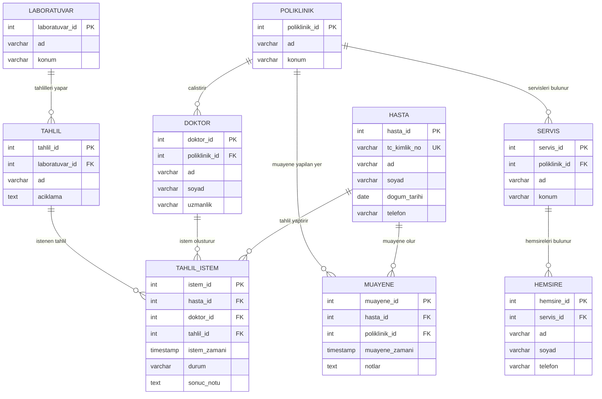

# Hastane Otomasyonu — Varlık-İlişki Diyagramı

## ER diyagramı

## İlişkiler ve kardinaliteler

| İlişki | Kardinalite | Uygulama |
|---|---|---|
| Poliklinik–Doktor | 1:N | `Doktor.poliklinik_id` yabancı anahtarı |
| Hasta–Poliklinik | N:M | `Muayene` ara tablosu |
| Hasta–Tahlil | N:M | `TahlilIstem` üzerinden |
| Doktor–Tahlil | N:M | `TahlilIstem` üzerinden |
| Laboratuvar–Tahlil | 1:N | `Tahlil.laboratuvar_id` yabancı anahtarı |
| Poliklinik–Servis | 1:N | `Servis.poliklinik_id` yabancı anahtarı |
| Servis–Hemşire | 1:N | `Hemsire.servis_id` yabancı anahtarı |

### Önemli tasarım notları
1. Bir doktorun yalnızca bir polikliniğe bağlı olması, doktor tablosundaki tek `poliklinik_id` alanıyla sağlanır.
2. Bir hemşirenin yalnızca bir serviste çalışması, hemşire tablosundaki tek `servis_id` alanıyla sağlanır.
3. Her tahlil türü yalnızca bir laboratuvara bağlıdır; laboratuvar birden çok tahlil türünü gerçekleştirebilir.
4. `TahlilIstem` bir işlem/ilişki tablosudur: hangi hastaya, hangi doktor tarafından, hangi tahlilin istendiğini kaydeder. Aynı tahlilin farklı hastalar için veya aynı hastaya farklı zamanlarda tekrar istenebilmesi nedeniyle `istem_id` kullanılır.
5. Diyagramdaki çizgiler her ana kaydın sıfır veya daha fazla ilişkili kaydı olabileceğini; her ilişkili kaydın ise ilgili üst kayda bağlı olduğunu gösterir.
